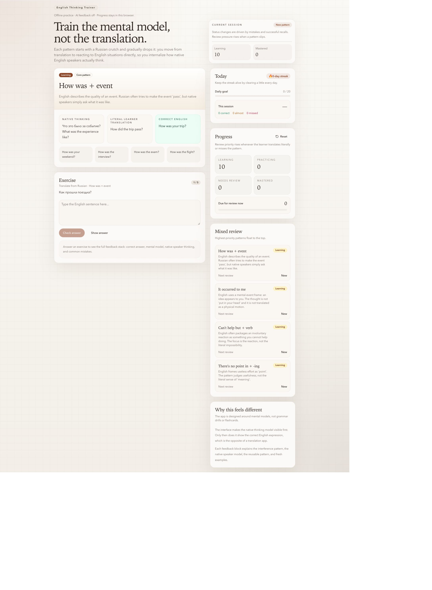

# English Thinking Trainer

[](https://github.com/kaprielov/english-thinking-trainer/actions/workflows/ci.yml)

A React + TypeScript practice app for moving from literal Russian translations to
reusable English constructions. Short sessions combine examples, progressively
reduced hints, answer feedback, and spaced repetition.

**[Try offline practice](https://kaprielov.github.io/english-thinking-trainer/)**



## Practice flow

1. Explore a construction, its meaning, and natural examples.
2. Complete a five-exercise session: translation, gap filling, rewriting, situations,
   and recognition, depending on the pattern's current learning stage.
3. Check an answer or reveal the reference and assess it yourself.
4. Return to due patterns before introducing more new material.

Progress, review dates, and activity statistics stay in browser local storage.
The public demo needs no account, API key, or AI service.

## Run locally

Requires Node.js 22.13+ and npm.

```sh
npm ci
npm run dev:client
```

```sh
npm test
npm run build
```

The build includes a separate strict TypeScript check. CI installs locked dependencies,
runs all deterministic tests, builds, and publishes an offline-only static demo.

## Grading and scheduling

| Decision                               | Behavior                                                                                                                |
| -------------------------------------- | ----------------------------------------------------------------------------------------------------------------------- |
| Exact reference match                  | Check locally, ignoring punctuation and case.                                                                           |
| Closed-choice recognition              | Decide locally against the supported answer set.                                                                        |
| Other free-text answer in offline mode | Show reference feedback and request self-assessment; an unavailable AI service never silently counts as a mistake.      |
| Optional AI feedback                   | A server-side adapter returns a rubric for construction use, grammar, and naturalness. Local decisions retain priority. |
| Review timing                          | An SM-2-style schedule updates intervals after graded recalls; ungraded answers do not reschedule a pattern.            |
| Exercise progression                   | Gradually reduce Russian hints and mix previously introduced patterns into later sessions.                              |

The rule-based matcher is a heuristic, not a general English grammar checker.
The scheduling design and examples have not been validated as a learning-outcome study.

## Optional local AI feedback

The public demo does not expose an AI endpoint. To enable the local gateway adapter:

```sh
cp .env.example .env
```

Set `VITE_ENABLE_AI=true` and `LLMGATEWAY_API_KEY` in `.env`, then run `npm run dev`
to start Vite and the loopback API together. The key stays server-side: never put it
in a `VITE_` variable. `DEEPSEEK_MODEL` optionally selects the gateway model.
Provider requests may incur charges. The API is a local prototype without user
authentication or production abuse controls; do not expose it as a public paid API.

## Code map

- [Session hook](src/hooks/useTrainingSession.ts): exercise lifecycle, grading orchestration, and persisted browser state.
- [Grading](src/lib/grading.mjs): deterministic matching, rubric combination, and offline handling.
- [Spaced repetition](src/lib/srs.mjs) and [activity statistics](src/lib/stats.mjs): independently tested pure functions.
- [Presentation](src/App.tsx): page composition, feedback, and progress components.
- [Local API](scripts/api-server.mjs): optional gateway adapter; tests inject the evaluator without provider calls.

## Current limits

A small curated pattern set, single-browser progress, no accounts or synchronization,
and no voice recognition. Stored state is not encrypted; use Reset to clear progress.
AI verdict quality needs separate evaluation. See [the content plan](PATTERNS_PLAN.md)
for the proposed review process for additional patterns.
